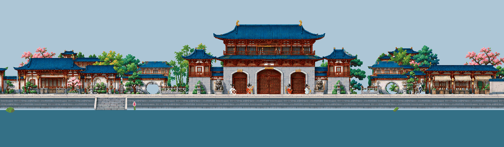
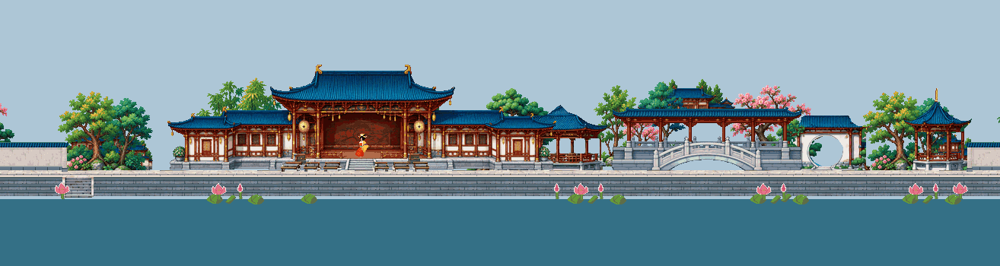

# 天朝 400u R12 素材交付

Refs [#101](https://github.com/baisiqi6/ohmymods/issues/101)。用户认可 R11 扩建方案后，明确授权后续素材制作与完整 Mod 隔离实装。本专项负责原创建筑/多层背景/独立人物与荷塘素材和精确布局数据；主线 PR #265 负责唯一运行消费者、资源嵌入、收费、场景/存档/坐骑和隔离安装。此 PR 不改共用入口。

生产包位于 [`il2cpp/Assets/Palace/Palace400R12`](../../../../il2cpp/Assets/Palace/Palace400R12/README.md)。86 PNG：54 完整实体、13 背景复合体、5 路岸模块、10 人物 atlas（294 时间帧）、4 荷塘 atlas（64 时间帧）。400u 的 11 区共 452 实例，未横拉原建筑。原三层唐塔与两端山石保留。

生产图与布局分离，Point/二值 alpha/透明 RGB0；环境使用冻结 B128-r2，玩家角色保留原色盘。每件有明确画布原点、master 映射和支撑点。新街面设计参考是 Y224，旧原图 Y 仅为来源记录；Native 地面、水面及人体标尺未填造值。宫门返程锚 `[218,176]` 与建筑支撑 `[218,178]` 分开声明。详见[消费者合同](consumer-layout-r12.md)。

Astra 已按实际 1x/4x 图审通过材质修整、完整补画、单体边缘和整 11 区离线组合。最终组合发现的普通远宫台基露空已通过逐实例落位修正关闭，未用拉伸、渐隐或盖条掩盖。审查报告保留其当时 registry SHA；最终冻结只更新批准/就绪元数据，86 PNG 和批准后的 layout 必须保持逐字节一致。

独立 GLM 数据合同审查、实际运行结果和最终 SHA 由本目录对应记录绑定。校验器复核完整文件图、358 时间帧直接 RGBA 回读、舞女 26 时间曝光/21 物理格、固定 pivot、色盘、4 非空背景层，以及精确离线批准与当前图一致。另有针对重签元数据后错误裁片、masterId、逃逸路径及多余文件的测试。

这次交付不声明 Native 通过。真实水岸高度差、BODY 与脚底、相机/旋转/视差揭露、遮挡、天气/运动，和自然收费进入→保存退出→新进程宫廷读档→返回、金币与坐骑携带，由主线在完整 Mod 独立副本与独立存档验证。Steam 和普通存档不在写入范围。所有对应 PR 合并前，#101 保持开放。

以下为离线合成，天空与水底色仅作诊断，不是游戏截图，也不在生产 PNG 中：

完整横卷：[offline-400u.png](offline-400u.png)。
